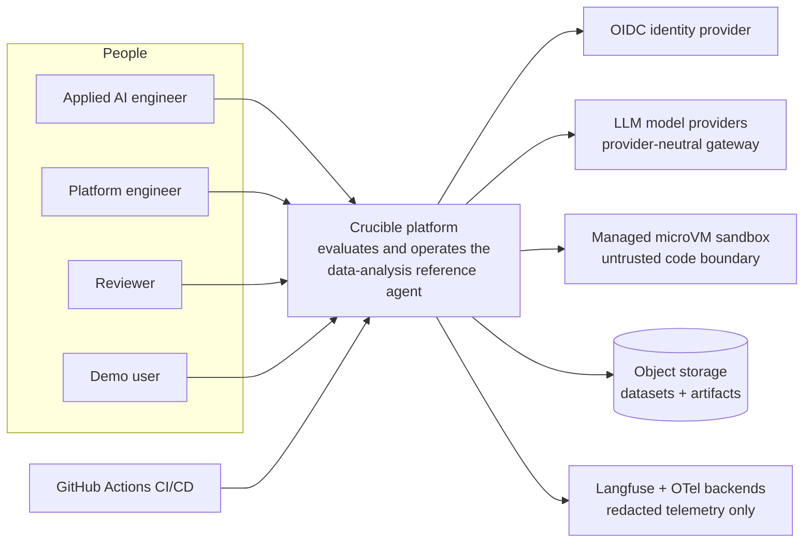
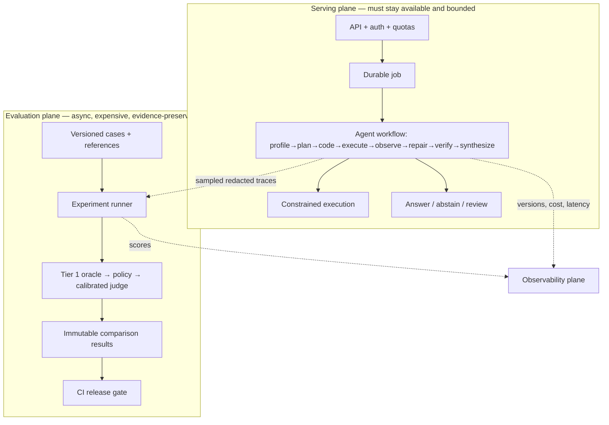

# Crucible — C4 Level 1 Context (with plane separation)

Status: Phase 0 baseline · Date: 2026-07-14

## System context

## Plane separation (the core architectural claim)

Rules encoded by this diagram:

1. The serving plane answers a request; the evaluation plane judges *changes to the
   agent*. They fail independently — analytics delay never degrades serving.
2. The evaluation plane never silently rewrites baselines.
3. The sandbox is outside the API/worker trust boundary (see ADR-003 and the threat model).
4. Only redacted, hashed, access-controlled content crosses into observability providers.

Container- and component-level diagrams (C4 L2/L3) are Phase 1–4 deliverables, created
as the corresponding services come into existence — not speculated here.
