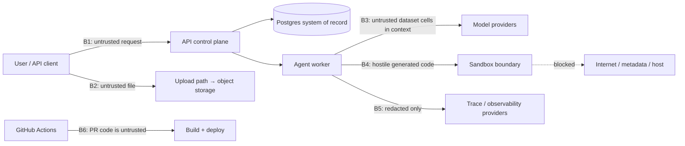

# Crucible Initial Threat Model v0.1.0

Status: Phase 0 baseline · Date: 2026-07-14 · Framework inputs: OWASP LLM Top 10, OWASP Agentic Applications guidance

Scope: every trust boundary that exists once the v1 workload ships. Each boundary maps
to controls **and** to test evidence — a control without a planned test is not counted.

## 1. Trust boundaries

## 2. Asset × threat × control × test matrix

| # | Asset / boundary | Threat | Core controls | Test evidence (phase) |
|---|---|---|---|---|
| T1 | User question (B1) | Direct prompt injection; instruction abuse | Question is data; tool capabilities cannot be expanded by text; strict typed tool schema | Injection cases in safety suite (P5); denied-tool audit (P4) |
| T2 | Dataset cells (B2/B3) | **Indirect prompt injection** in cells; formula/parser abuse; PII exposure | Every cell is untrusted data in a delimited channel, never elevated to instructions; size/type limits before parsing; PII scan before third-party calls | Malicious-cell behavioral tests: no tool/policy change, no exfiltration (P5) |
| T3 | Generated code (B4) | Host escape, exfiltration, resource exhaustion, secret theft | MicroVM/dedicated boundary in prod; fixed pinned image; non-root; read-only dataset; no network/DNS/metadata; no Docker socket/host mounts/privileged mode; CPU/mem/proc/disk/wall-clock caps; fresh sandbox per attempt; **model never chooses image, flags, mounts, or packages** | Escape/egress/resource/secret canaries all fail closed (P3); manual review |
| T4 | Sandbox control plane | Agent-influenced launcher config; control-credential leakage | Backend constructs fixed config; provider credentials isolated from runner; no secrets mounted | Environment/filesystem secret-search canary (P3) |
| T5 | Tenant data (DB/storage) | Cross-tenant access (IDOR), retention failure | Org-scoped authz in every use case and repository query; storage IAM per tenant; opaque IDs; audit events; deletion workflow | Guessed-ID negative tests; cross-tenant artifact-grant substitution → 403 (P2/P3) |
| T6 | API (B1) | Auth bypass, replay, upload abuse, rate-limit bypass | OIDC/JWT server-side validation; RBAC default-deny; idempotency keys; layered rate limits; WAF; presigned scoped upload URLs | Authz/IDOR/replay/oversize test suite (P2) |
| T7 | LLM context | Secret or cross-tenant data reaching a provider | No secrets in prompts; profile summaries instead of raw tables where possible; provider data path documented; redaction before calls where feasible | Context-content assertions in integration tests (P4) |
| T8 | Trace/eval store (B5) | Sensitive prompt/data leakage; forged feedback | Redaction before export; content hashes + access-controlled artifact links instead of raw data; retention policy; reviewer identity + append-only audit | Redaction tests; exported-payload field assertions (P6) |
| T9 | CI/CD (B6) | Secret theft, poisoned action, untrusted PR execution | OIDC short-lived creds; SHA-pinned actions; read-only default token; no `pull_request_target` with secrets; CODEOWNERS on workflows/infra/eval baselines; **generated code never runs on shared runners** | Workflow lint + permissions review (P1/P9) |
| T10 | Supply chain | Vulnerable dependency/image | Lockfiles; SBOM; CodeQL/Semgrep/Trivy/Gitleaks; signed images; Dependabot/Renovate cadence | Scan gates in CI (P1→P9) |
| T11 | Model output | Malicious artifacts (HTML/JS/SVG/zip-bomb), schema spoofing | Strict artifact parser; MIME/path validation before publishing; UI escaping; download disposition | Hostile-artifact test set (P3/P7) |
| T12 | Memory/context poisoning | Poisoned long-term memory | **No cross-user memory in v1** (architectural elimination); future retrieval corpus is versioned, tenant-scoped, poison-tested | Scope check: feature absent (P0 decision) |

## 3. Data classification

| Class | Examples | Default handling |
|---|---|---|
| Public synthetic fixture | `evals/fixtures/*` | Committed to repo; only class allowed in eval fixtures |
| Customer confidential | Uploaded datasets, results | Default class for uploads; encrypted, tenant-scoped, retained per policy |
| Personal data | PII inside uploads | Minimize; redact/tokenize before third-party providers; deletion workflow |
| Restricted secret | API keys, provider creds, signing keys | Secret Manager only; never in prompts, images, traces, or repo |

## 4. Standing rules

1. A failed code run is **never** fixed by granting more sandbox access, time, or resources.
2. No untrusted input (question, cell, model output) influences sandbox configuration, tool choice, or credentials.
3. Egress exceptions require an ADR, an allowlist, per-run audit, and user-visible disclosure. v1 has none.
4. Eval fixtures must never contain production data or credentials.
5. Injection suspicion is terminal — logged, audited, never retried.

## 5. Implemented controls by phase

### Phase 2 — identity and data plane (2026-07-14)

| Threat | Control now in place | Evidence |
|---|---|---|
| T5 cross-tenant access | Every repository read takes `organization_id` explicitly; cross-tenant reads return **404, not 403**, so IDs cannot be probed for existence. Object keys are tenant-prefixed (`org/{id}/…`). | `tests/security/test_tenant_isolation.py` — 20 cases: read, list, cancel, complete-upload, download-URL minting, run creation, key revocation, and header-based tenant switching |
| T6 API auth | OIDC JWT (signature/issuer/audience/expiry) or Argon2id-hashed API keys; expiry and revocation take effect immediately; RBAC is default-deny and checked inside each use case, not at the route. | `test_jwt_verifier.py`, `test_api_keys.py`, `test_identity_policy.py` |
| Privilege escalation | An API key can never exceed its creator's permissions, and `scopes` only ever intersect a role. `owner` holds an exclusive `org:manage` permission, so `admin` is strictly below it. | `test_admin_cannot_mint_a_key_beyond_their_own_permissions` |
| T2 hostile uploads | Size/type/extension policy is enforced **before** a presigned URL exists; the parser (not the declared content type) is the authority; row/column caps guard decompression bombs; a client-declared SHA-256 is re-computed from the stored bytes, and a mismatch is a terminal `invalid`. | `test_profiler.py`, `test_declared_hash_must_match_the_uploaded_bytes` |
| Audit evidence | Denials (401 and 403) are written in their **own transaction** — the request's session is rolled back when auth fails, so an audit row attached to it would vanish exactly when it matters. Download-URL issuance is audited. | `test_failed_authentication_is_audited`, `test_sensitive_actions_are_audited` |
| Unbounded consumption | Per-principal rate limits; expensive routes **fail closed** when the limiter is unavailable rather than admitting unaccounted work. | `RateLimit` in `apps/api/.../dependencies.py` |

**Known gap carried forward:** rate limits are per-principal only. Per-organization
token/cost budgets arrive with Phase 8, and unauthenticated IP-level limiting is a
WAF concern in Phase 9.

### Phase 3 — isolated execution and safety canaries (2026-07-15)

The execution boundary for model-generated code (threat T3/T4/T11) is built and
proven. Full detail and the control-to-canary matrix live in
[docs/security/sandbox.md](sandbox.md); summary:

| Threat | Control now in place | Evidence |
|---|---|---|
| T3 host escape / RCE | Fixed hardened runner: non-root, all caps dropped, no-new-privileges, read-only root, no Docker socket, private IPC. The model contributes only program source + dataset bytes; the request schema has no field for image/mount/network/caps/env. | `tests/sandbox/test_canaries.py` — privilege, docker-socket, read-only-root, schema canaries |
| T3 network exfiltration | `network_disabled` + `network_mode=none`: no egress, no DNS, no metadata endpoint. | outbound-TCP, DNS, cloud-metadata canaries (all blocked) |
| T3 resource exhaustion | Memory (no swap), CPU, pids, wall-clock, per-file (RLIMIT_FSIZE), and total-output caps; fresh container per attempt, force-destroyed. | memory/CPU/fork/file-size/output-bomb canaries (all contained) |
| T4 sandbox control plane | The backend constructs a fixed config; the compose worker has no Docker socket and defaults to the fake backend; the microVM adapter refuses a weaker fallback. | ADR-003; `executor_backend` default `fake` |
| T4 secret disclosure | The harness passes the child a minimal environment (two fixed paths); no host credential is inherited into the guest. | no-host-secrets canary |
| T11 malicious output | Extension allowlist, symlinks rejected, per-file/total caps, JSON-object result contract; stdout is never trusted as the result. | malicious-artifact, symlink, non-object-result, output-cap canaries |
| Cross-tenant data (T5 at the sandbox) | Only the single assigned dataset is mounted, read-only; no other file is visible. | assigned-dataset-only canary |

**Latest canary run:** 20/20 passing (Docker 29.6.1). **Known limitations**
(carried forward): the Docker backend is local-dev only; production microVM
provider integration and base-image digest pinning land in Phases 9–10.

## 6. Review cadence

Threat model reviewed at each phase exit that adds a boundary (P2 data plane, P3
sandbox, P6 telemetry, P9 CI/CD hardening) and after any security incident.
